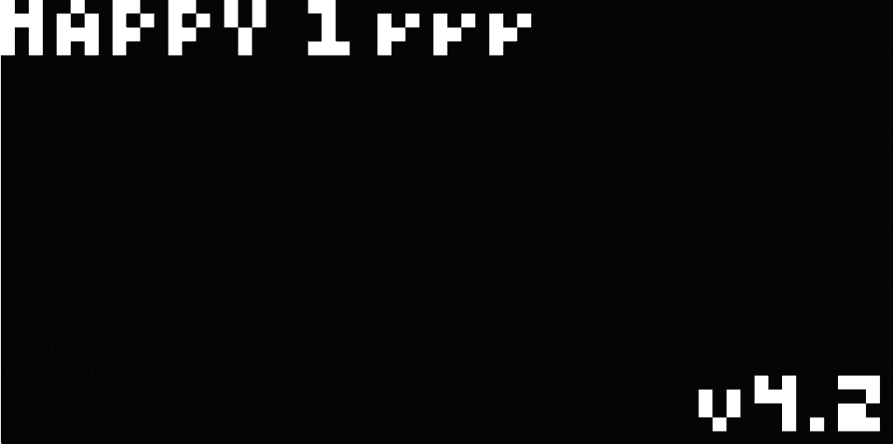

# CHIP-8 Emulator

A CHIP-8 emulator written in C++, with a raylib frontend and an ImGui debugger.



## Features

- All original CHIP-8 opcodes
- 64×32 display, 16-key keypad, delay and sound timers
- Debug mode: step one instruction at a time and inspect registers, stack and memory around PC
- Frontend-independent emulator core with unit tests (Catch2)

## Design

The emulator core (`src/chip8.cpp`) is written to function on its own without depending on raylib or ImGui, allowing for fast tests.
Keyboard state, drawing to the screen and debugging panels are handled by the frontend.

## Building

Requirements: CMake 3.20+, a C++20 compiler, and [raylib](https://www.raylib.com/) installed
on the system. Dear ImGui, rlImGui and Catch2 are downloaded automatically by CMake.

```sh
./run.bash <rom.ch8>
```

## Usage

```
chip8 [--debug] [--no-audio] <rom.ch8>
```

| Option | Effect |
|---|---|
| `--debug` | Show the debugger panel; press **Space** to execute one instruction |
| `--no-audio` | Don't open an audio device |

### Keypad

The CHIP-8 hex keypad is mapped to the left side of a QWERTY keyboard:

```
CHIP-8        Keyboard
1 2 3 C       1 2 3 4
4 5 6 D       Q W E R
7 8 9 E       A S D F
A 0 B F       Z X C V
```

## Tests

```sh
./run_tests.bash
```

## Credits

The ROMs in `ressources/` were written by others and are included for testing; see
[`ressources/README.md`](ressources/README.md).
